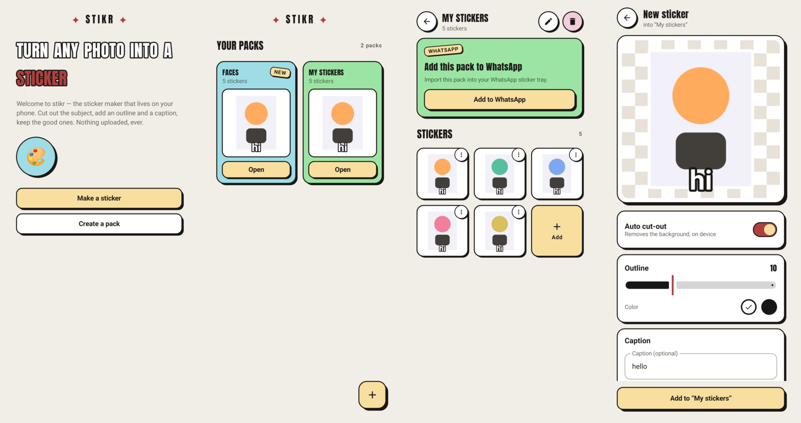

# stikr

**Current version: v0.1** — photos in, stickers out.

Turn a photo into a sticker on your phone — cut out the subject, add an outline
and a caption, then import the pack straight into WhatsApp or share a sticker
anywhere. No account, no upload, no watermark.

<p align="center">
  <a href="https://github.com/mrduhlol/stikr/releases/latest/download/stikr.apk">
    
  </a>
  <br />
  <sub>Tap the button on your phone — the APK installs straight from your files.</sub>
  <br /><br />
  
  
  
  
</p>

## Features

- **Auto cut-out, on device** — the subject is cut from the background by ML Kit
  subject segmentation; the model is fetched once by Google Play services and
  everything runs locally
- **A real sticker look** — an outline (white or ink, adjustable thickness) and
  an optional caption in four colours, top or bottom
- **A sticker-book look** — cream paper, ink outlines, hard offset shadows and
  pastel cards; heavy Anton display type; light and dark
- **Packs** — create, rename, and delete packs; add and delete stickers
- **Add to WhatsApp** — export a pack (3–30 stickers) through the standard
  sticker-pack contract; stikr works with WhatsApp and WhatsApp Business
- **Share a sticker** — send any sticker as a PNG through the normal share sheet
- **Works offline** — no account, no sign-in, nothing is uploaded; cut-out needs
  Google Play services, and everything else works without it
- **Light and dark** — follows your phone's theme

## Install

1. Tap **DOWNLOAD APK** above on your phone
2. Open the downloaded file
3. Allow **Install unknown apps** when asked
4. Tap **Install**

Every release is signed with the same key
(`keystore/release.p12`), so the next version installs straight over the one
you have. If you previously sideloaded a debug build, uninstall it first —
different signature, Android will refuse the update.

## Use

1. Open **stikr** and tap **Make a sticker** (or create a pack first)
2. Pick a photo — stikr cuts out the subject automatically
3. Adjust the **outline**, add a **caption** if you like, then tap **Add to pack**
4. Once a pack has 3 or more stickers, tap **Add to WhatsApp** to import it;
   or use a sticker's menu to **Share** it as an image

## Design



The look is a sticker book: cream paper, 2 dp ink outlines, hard offset shadows
(never blurred), pastel card fills, and one loud red accent. Headlines are set
in Anton; the home slogan is drawn as a sticker itself — white fill, ink
outline, hard ink shadow, accent word in red.

- `ui/theme/Theme.kt` — the palette (`NeoPalette`, exposed as `Neo.palette`),
  Material 3 colour mapping, shapes, type scale. Pastel fills always carry
  `onAccent` dark ink, so the look survives dark mode.
- `ui/neo/Neo.kt` — the component kit: `neoFrame` (border + hard shadow),
  `NeoCard`, `NeoButton`, `NeoIconButton`, `NeoChip`, `NeoTag`, `NeoDialog`,
  `NeoTextField`, `StickerHeadline`, `NeoSnackbar`.
- Font: Anton, bundled under the SIL Open Font License
  (`licenses/anton-OFL.txt`).
- App icon: the sticker "S" — a white mark with a peeled corner on purple
  (`#723AF4`). Source: `docs/brand/logo.png`; the adaptive icon uses it as a
  raster foreground (`res/mipmap-*/ic_launcher_foreground.png`) over the
  purple background colour.

## Development

- Kotlin + Jetpack Compose (Material 3), minSdk 26, one module
- Build and install from source:

  ```bash
  ./gradlew :app:assembleDebug
  # then, with a phone connected:
  adb install app/build/outputs/apk/debug/app-debug.apk
  ```

  Or open the project in Android Studio and press Run.
- Releases: bump `versionName`, push a `v*` tag — the
  `build-apk.yml` workflow builds and signs the APK with
  `keystore/release.p12` and attaches `stikr.v<version>.apk` plus a stable
  `stikr.apk` to the GitHub Release. Pushes to `main` only build a debug
  APK for smoke testing, and debug builds cannot update each other (each
  CI runner uses its own throwaway debug key) — install tagged releases.
- `render/StickerRenderer.kt` draws the final 512x512 sticker: dilated
  silhouette for the outline (white or ink), subject on top, caption last
- `render/StickerCodec.kt` encodes WebP and walks the quality down until the
  file fits WhatsApp's limits (100 KB per sticker, 50 KB per tray icon)
- `editor/SubjectCutout.kt` wraps ML Kit subject segmentation in a suspend
  function that returns null whenever cut-out is unavailable
- `data/PackRepository.kt` stores packs as files + `pack.json` under the app's
  private storage — no database
- `export/StickerPackContentProvider.kt` implements WhatsApp's pack contract
  (metadata + `stickers_asset` + `sticker_pack_icon`)
- Visual review without a device:
  - `./gradlew testDebugUnitTest` renders sample stickers to
    `app/build/sticker-renders/` (Robolectric)
  - `./gradlew testDebugUnitTest --tests "com.stikr.app.ui.ScreenRenderTest"`
    renders whole screens — light and dark, dialogs included — to
    `app/build/ui-renders/`; the committed copies live in `docs/theme/`
